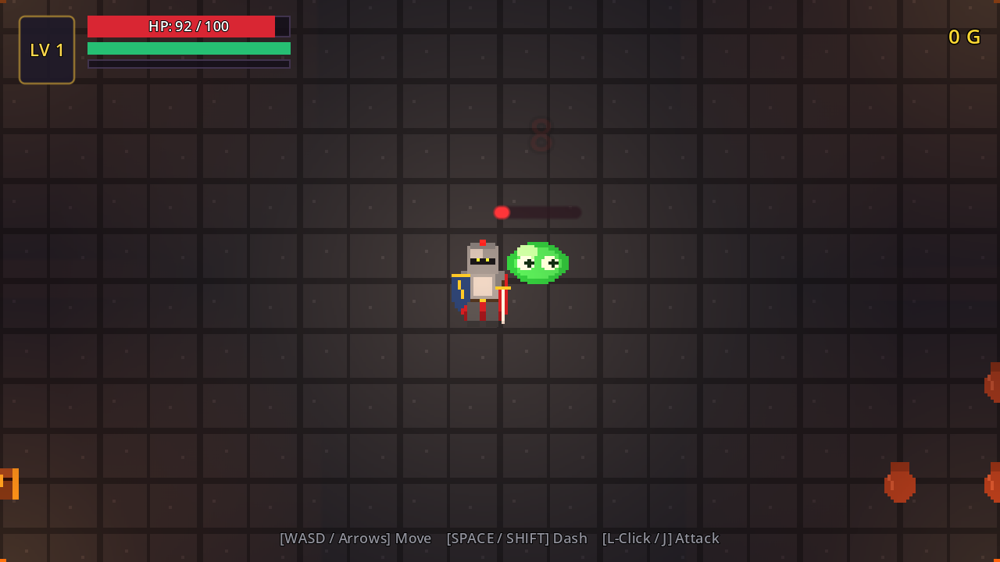

# ⚔️ Aethelgard: Dungeon of Shadows

Um RPG de Ação & Dungeon Crawler 2D com visão de cima (Top-Down), pixel art nítido, combate dinâmico e jogabilidade fluida construído nativamente em **Godot 4.3**.



---

## 🎮 Controles

| Ação | Teclado / Mouse |
| :--- | :--- |
| **Mover Cavaleiro** | `W`, `A`, `S`, `D` ou `Setas Direcionais` |
| **Esquiva / Dash (com I-frames)** | `Barra de Espaço` ou `Shift` (consome estamina) |
| **Ataque de Espada** | `Clique Esquerdo do Mouse` ou tecla `J` / `K` |
| **Reiniciar / Jogar Novamente** | Tecla `R` ou botão na tela de Derrota/Vitória |

---

## ✨ Características do Jogo

- **Combate de Ação Ágil**:
  - Movimentação suave em 8 direções.
  - Dash com velocidade explosiva e *I-frames* (quadros de invulnerabilidade) para desviar de magias e golpes.
  - Combo de espada com arcos de corte cortantes (*slash VFX*), empurrão (*knockback*) e tremor de tela (*screen shake*).
- **Inimigos & Boss**:
  - 🟢 **Slime das Catacumbas**: Pula em direção ao herói com animação elástica e ataque de impacto.
  - 💀 **Guerreiro Esqueleto**: Patrulha os corredores com escudo de madeira e golpes de espada enferrujada.
  - 🧙‍♂️ **Malakor, o Imortal (Chefe)**: Mago necromante com duas fases de combate, projéteis sombrios teleguiados, rajada tripla no modo enfurecido e teletransporte instantâneo caso o jogador se aproxime demais!
- **Masmorra Viva & Interativa**:
  - Pisos de pedras e lajes com musgo.
  - Tochas dinâmicas de parede com iluminação 2D cintilante e lanterna de herói.
  - Vasos de cerâmica quebráveis que espalham moedas e poções.
  - Baús do tesouro que se abrem espalhando chuva de ouro e gemas de experiência.
- **Progressão & HUD Completo**:
  - Barra de Vida (HP) com texto numérico.
  - Barra de Estamina que recarrega continuamente.
  - Barra de XP e sistema de **Level Up** (restaura vida, aumenta dano e exibe notificação triunfal).
  - Contador de moedas de ouro coletadas.
  - Barra de Vida imponente para o Chefe Malakor ao entrar no santuário.
- **Áudio Retrô Chiptune/16-bit**:
  - Efeitos sonoros para espadada, impacto, dano recebido, dash, tilintar cristalino de moedas, abertura de baú, fanfarra de subida de nível, rugido do chefe e drone ambiente de masmorra.

---

## 🚀 Como Executar

### Opção 1: Pelo Godot Editor
1. Abra o **Godot 4.3**.
2. Clique em **Importar** (Import) e selecione a pasta do projeto (`project.godot`).
3. Pressione **F5** (ou o botão Play no canto superior direito).

### Opção 2: Linha de Comando
```bash
godot --path . res://src/scenes/main.tscn
```
